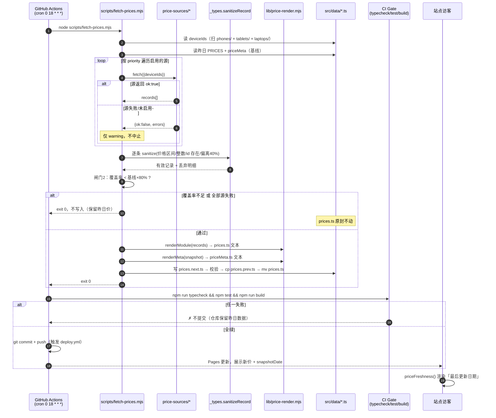
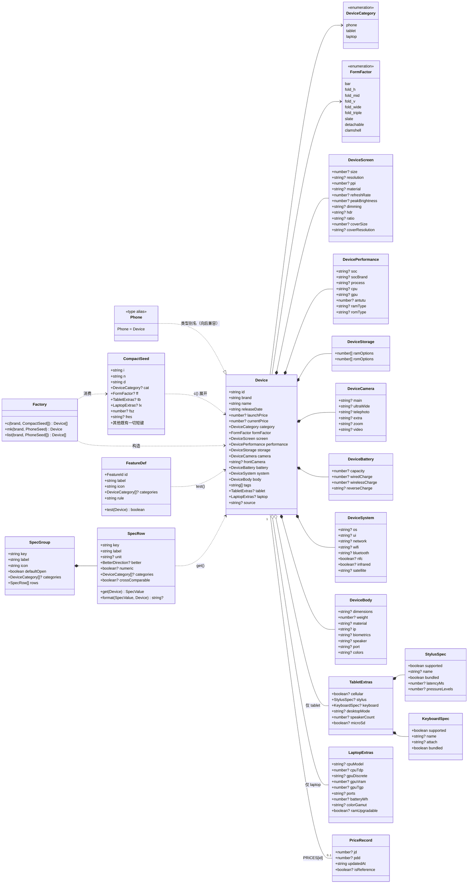
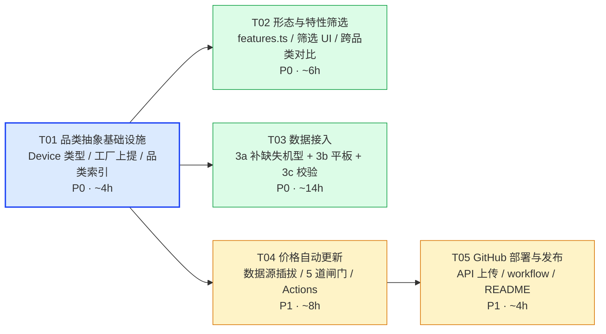

# 增量架构设计：手机 → 多品类设备参数对比

> 版本：2026-10-14 · 架构师：高见远（Gao）
> 状态：**只做设计，未修改任何代码文件**
> 基线：`Vite5 + React18 + TS(strict) + Tailwind3 + react-router6(HashRouter) + vitest`，455 款手机（16 品牌文件，426 条 `CompactSeed` + 29 条 `PhoneSeed`），116 项测试全绿

---

## 0. 现状盘点（读代码确认，非转述）

| 层 | 文件 | 行数 | 本次演进中的角色 |
|---|---|---|---|
| 类型 | `src/types/phone.ts` | 214 | `Phone` 是全局事实标准（100+ 处引用），**必须向后兼容** |
| 工厂 | `src/data/phones/_factory.ts` | 330 | `CompactSeed`(`c()`) / `PhoneSeed`(`mk()`)，455 条数据的唯一入口 |
| 品牌数据 | `src/data/phones/*.ts` | 16 个 | 426 + 29 = 455 条，**本次不应要求改其中任何一行** |
| 索引 | `src/data/index.ts` | 214 | `ALL_PHONES` / `PHONE_MAP` / `PRICE_BOUNDS` / `BRANDS` / `YEARS` … |
| 参数分组 | `src/data/specGroups.ts` | 535 | 9 组，`SpecRow.get(phone)` 取值 + `computeRowDiff` 差异判定 |
| 价格 | `src/data/prices.ts` | 304 | 235 条渠道价，**脚本可整文件重写** |
| 价格口径 | `src/utils/price.ts` / `effectivePrice.ts` | 136 / 21 | 手写逻辑，**绝不可被脚本碰**（历史事故） |
| 常量 | `src/constants.ts` | 50 | `SUBSIDY_POLICY` / `DATA_UPDATED_AT` / `REPO_URL` |
| 页面 | `LibraryPage` / `ComparePage` | 191 / 282 | 依赖 `ALL_PHONES`、`useFilters(ALL_PHONES)` |
| 组件 | `PhoneCard` / `FilterPanel` / `SpecTable` / `CompareBar` / `BrandAvatar` | 227 / 262 / 156 / 84 / 73 | `PhoneCard` 与 `SpecTable` 是品类扩展的主战场 |
| 脚本 | `scripts/import-prices.mjs` | ~16KB | 只读本地 CSV/JSON，合规声明完整，**无网络逻辑** |
| 脚本 | `scripts/fetch-phones.mjs` | ~20KB | 既有抓取器（本次不复用，仅参考其适配器模式） |
| 部署 | `.github/workflows/deploy.yml` | 59 | **质量已达标**：`base:'./'` + HashRouter + `permissions` 正确，可直接沿用 |
| Git | `.git/` | 残缺 | 只有 `description/hooks/info/config.lock`，**无 `objects`/`refs`** → `git init` 被安全策略拦断，仓库不可用 |

### 0.1 三个必须先承认的约束

1. **`.git` 是残缺目录**，`git remote -v` 直接报 `fatal: not a git repository`。所以「部署到 GitHub」只能走 **GitHub API 逐文件 PUT**（或 `gh` CLI），不能走 `git push`。
2. **`src/data/prices.ts` 会被脚本整文件重写**。历史上把口径函数写进该文件，`--overwrite` 后编译失败白屏。本次设计必须把「脚本可重写的数据」与「手写的逻辑」**物理隔离**。
3. **`tags: string[]` 语义混杂**：现有值里同时存在「档位」（旗舰/中端/入门）、「卖点」（影像旗舰/自拍/轻薄/长续航）、「形态」（折叠屏）、「调性」（奢华/时尚/设计）。做筛选 UI 时无法分组，也无法表达「小屏手机」这类需要参数判定的特性。

---

# 一、品类抽象设计（核心）

## 1.1 三个方案对比

| 维度 | 方案 A：单类型 + `category` 字段 | 方案 B：并行独立类型（新建 `Tablet`） | **方案 C：Device 核心 + 品类扩展块（推荐）** |
|---|---|---|---|
| 做法 | `Phone` 直接加 `category`；平板专属字段（手写笔/键盘/蜂窝版…）全部加为 `Phone` 的可选字段 | 新建 `Tablet` 接口 + `src/data/tablets/` + 一套 `TabletCard`/`TabletSpecTable` | `Device` = 现有 `Phone` 全部字段 + `category` + `formFactor` + `tablet?` / `laptop?` 扩展块；`Phone` 降为 `Device` 的类型别名 |
| 455 款手机数据改动 | 0 | 0 | **0** |
| 改动文件数（本期） | 8 | 25+ | **6**（T01） |
| 加笔记本时的改动 | 继续往 `Phone` 里塞字段 → 60+ 字段的**上帝对象**，无法表达「哪些字段属于笔记本」 | 再造一套 `Laptop` + 一套组件 + 一套页面，**代码翻倍** | 加 `LaptopExtras` 接口 + `src/data/laptops/` 目录 + 1 个参数组文件，**核心零改动** |
| 类型安全 | 弱：`Device.stylus` 在手机上永远是 `null`，但 TS 无法阻止你在手机渲染里读它 | 强，但重复代码 | **强**：`device.tablet?.stylus` 天然带 narrowing，且「品类专属」语义显式 |
| 筛选/对比/参数组的复用 | 全部要写 `if (category === ...)` 分支 | 全部要写两遍 | 一份 `SpecRow` + `categories?: DeviceCategory[]` 声明即可按品类裁剪 |
| 迁移风险 | 低（但技术债立刻产生） | 高（两套 UI 会立刻开始分叉） | **低**：`export type Phone = Device` 让 116 项测试与所有组件零改动编译通过 |
| 结论 | ❌ 技术债立刻爆发 | ❌ 违反「不为两分法设计」的要求 | ✅ |

### 选中方案 C，理由是三点：

1. **零数据迁移**：`c()` / `mk()` 工厂给 `category` 填默认值 `'phone'`、`formFactor` 填 `'bar'`，455 条 `CompactSeed` 一行不改。
2. **`export type Phone = Device` 是关键的兼容阀门**。全项目 100+ 处 `Phone` 引用、`SpecRow.get: (p: Phone) => SpecValue`、7 个测试文件全部继续编译通过；新代码统一写 `Device`，老代码自然腐化淘汰。
3. **扩展块天然隔离品类污染**。加笔记本时只动 `LaptopExtras` + 一个新目录 + 一个参数组文件，`Device` 本体与所有页面零改动——这正满足「架构必须为笔记本预留扩展位，不要设计成手机+平板两分法」。

## 1.2 三类设备的字段复用与差异

### 可直接复用（无需改结构，靠 `null` 表达「不适用」）

| 现有块 | 手机 | 平板 | 笔记本（预留） | 结论 |
|---|---|---|---|---|
| `screen`（size/resolution/ppi/material/refreshRate/peakBrightness/dimming/hdr/ratio） | ✅ | ✅ 完全复用 | ✅ 复用，另加色域/色准（`LaptopExtras.colorGamut`） | **100% 复用** |
| `performance`（soc/socBrand/process/cpu/gpu/antutu/ramType/romType） | ✅ | ✅ 复用（iPad M5 / 骁龙 8 Elite 平板版同样有跑分） | ⚠️ 复用 `soc`，但需 `cpuTdp`/`gpuDiscrete`/`gpuTgp` → 放 `LaptopExtras` | **复用 + 笔记本扩展** |
| `storage`（ramOptions/romOptions） | ✅ | ✅ | ✅（笔记本需 `ramUpgradable` → 扩展块） | **复用** |
| `camera`（main/ultraWide/telephoto/extra/zoom/video） | ✅ | ✅ 复用，平板多填 `null` | ❌ 笔记本多数为 `null`（摄像头仅摄像用） | **复用，全部字段本就可空** |
| `frontCamera` | ✅ | ✅（平板前置是核心卖点） | ✅ | **复用** |
| `battery`（capacity/wiredCharge/wirelessCharge/reverseCharge） | ✅ | ✅（平板 8000-12000mAh 直接填） | ⚠️ 笔记本行业惯例用 **Wh** 而非 mAh → `LaptopExtras.batteryWh`，`capacity` 留 `null` | **复用 + 单位扩展块** |
| `system`（os/ui/network/wifi/bluetooth/nfc/infrared/satellite） | ✅ | ✅（`network` 填「Wi-Fi 版 / 5G 版」即可区分蜂窝版） | ✅ | **复用** |
| `body`（dimensions/weight/material/ip/biometrics/speaker/port/colors） | ✅ | ✅ | ✅（重量单位差异见下） | **复用** |
| `tags` | ✅ | ✅ | ✅ | **复用，但语义需收窄**（见 §2） |

### 需要「可选化 / 单位归一」的两处

| 问题 | 现状 | 处理 |
|---|---|---|
| **重量单位** | `body.weight: number \| null`（手机 168-251 g） | 平板 682 g（iPad 13"）/ 笔记本 1.5 kg。**统一存 g**，展示层按品类格式化：`≥1000 && category==='laptop'` → `1.5kg`，否则 `682g`。格式化逻辑放 `src/utils/format.ts`（手写，脚本不碰） |
| **电池单位** | `battery.capacity: number \| null`（mAh） | 平板/手机继续用 mAh；笔记本用 `LaptopExtras.batteryWh`（Wh）。**不转换、不猜测**——Wh→mAh 需要电压，无法反推 |
| **`camera` 对平板是弱项** | 已全部 `null` 安全 | 参数组层面处理：`camera` 组的 `categories` 标注为 `['phone','tablet']`，笔记本自动不渲染该组 |
| **`port` 数量**（笔记本卖点） | `body.port: string \| null`（手机只有 `USB-C 3.1`） | 笔记本接口数量进 `LaptopExtras.ports`，避免撑大 `body` |

### 品类专属扩展块

```ts
// 平板专属
export interface TabletExtras {
  /** 是否有蜂窝数据版（LTE / 5G）*/
  cellular: boolean | null;
  /** 手写笔 */
  stylus: StylusSpec | null;          // { supported, name, bundled, latencyMs, pressureLevels }
  /** 外接键盘 */
  keyboard: KeyboardSpec | null;      // { supported, name, attach: 'pogo'|'magnetic'|'bluetooth'|'none', bundled }
  /** 桌面 / 生产力模式：Samsung DeX / 华为桌面模式 / iPadOS 台前调度 */
  desktopMode: string | null;
  /** 扬声器数量（平板 2/4/8 是硬指标）*/
  speakerCount: number | null;
  /** 是否支持 microSD 扩展 */
  microSd: boolean | null;
}

// 笔记本专属 —— 本期零数据，只定义接口，占住扩展位
export interface LaptopExtras {
  cpuModel: string | null;
  cpuTdp: number | null;              // W
  gpuDiscrete: string | null;
  gpuVram: number | null;             // GB
  gpuTgp: number | null;              // W
  ports: string | null;               // '雷电4 x2 / USB-A x2 / HDMI 2.1 / SD'
  batteryWh: number | null;
  colorGamut: string | null;          // '100% DCI-P3'
  ramUpgradable: boolean | null;
}
```

> **`LaptopExtras` 本期就定义、就接线（`Device.laptop?`、`c()` 的 `lx` 键、`LAPTOP_SPEC_GROUPS` 的空壳分组），只是不填数据。**
>
> ⚠️ **短键是 `lx`，不是 `lp`** —— `lp` 在既有 `CompactSeed` 里已经是「首发价 launchPrice」，
> 455 条种子全在用（如 `{i:'iphone-15-pro', d:'2023-09', lp:9999, cp:7999}`）。
> 用 `lp` 会直接撞键、455 条全部类型错误，正好打在「零数据改动」这条底线上。
> **新增任何短键前必须对既有键表查重**（见 §七 共享知识第 16 条）。
> 这正是「为笔记本预留扩展位」的落地方式：不是留一句 TODO 注释，而是让整条链路（类型 → 工厂 → 参数组 → 筛选 → 对比）现在就跑通，将来只需往 `src/data/laptops/*.ts` 里灌数据。

## 1.3 迁移成本评估（选 C 的账）

| 工作项 | 文件 | 是否要动 455 条数据 | 工作量 |
|---|---|---|---|
| 新建 `Device` 类型 + 品类扩展块 | `src/types/device.ts`（新） | 否 | 0.5h |
| `Phone` 降为别名、`SpecRow`/`SpecGroup` 加品类声明 | `src/types/phone.ts`（改） | 否 | 0.5h |
| 工厂上提一层 + 新增 `cat`/`ff`/`tb`/`lx`/`fsz`/`fres` 短键 | `src/data/_factory.ts`（新，从 `phones/_factory.ts` 移） | 否 | 1.5h |
| 一行转发，保证 16 个品牌文件零改动 | `src/data/phones/_factory.ts`（改为 1 行 re-export） | 否 | 5min |
| `ALL_DEVICES` / `DEVICE_MAP` / 分品类派生索引 | `src/data/index.ts`（改，保留 `ALL_PHONES` 别名） | 否 | 1h |
| 品类 / 形态常量 | `src/constants.ts`（加） | 否 | 0.5h |

**合计 ≈ 4h，455 条数据 0 改动，116 项测试 0 改动。**

### 为什么是「工厂上提」而不是让 `tablets/` 反向 import `../phones/_factory`

`src/data/tablets/apple.ts` 里写 `import { c } from '../phones/_factory'` 技术上可行，但会让目录依赖变成「平板依赖手机」——将来加笔记本又变成「笔记本依赖手机」，语义彻底错乱。

正确做法：`_factory.ts` 上提到 `src/data/_factory.ts`，`src/data/phones/_factory.ts` 保留为一行：

```ts
export * from '../_factory';
```

这样 16 个品牌文件的 `import { c, type CompactSeed } from './_factory'` **一个字都不用改**。

### 为什么不是「新建 `tablet` 目录 vs 改 `Phone`」的二选一

这是伪二选一。**目录要新建，类型不新建**。

- 数据组织上：`src/data/tablets/{apple,huawei,xiaomi,lenovo,honor,oppo,vivo,samsung,...}.ts` —— 按品类分目录，语义清晰，80-120 款平板不会淹没在 455 款手机里
- 类型上：它们全部产出 `Device`，进同一个 `ALL_DEVICES`
- 索引上：`src/data/index.ts` 汇总，与手机完全对称

## 1.4 跨品类对比：可以，但要降级

**规则：同品类内自由对比；跨品类默认禁止，显式开启后降级为「只读对比」。**

| 模式 | 触发条件 | 渲染的行 | 最优/最弱高亮 | 提示 |
|---|---|---|---|---|
| `same-category` | 参与对比的设备 `category` 全相同 | 该品类的全部参数组 | ✅ 正常判定 | 无 |
| `cross-category` | 出现 ≥2 个不同品类 | **只渲染 `crossComparable: true` 的行** | ❌ 全部关闭 | 顶部黄条提示「跨品类对比，已隐藏不可比项且不做优劣判定」 |

`SpecRow` 因此新增两个可选字段：

```ts
export interface SpecRow {
  // ...既有字段不变
  /** 该行适用的品类；缺省 = 全品类。判定：参与对比的设备品类必须**全部**命中 */
  categories?: DeviceCategory[];
  /** 该行适用的形态；缺省 = 全形态。判定：参与对比的设备形态**任一**命中即可 */
  formFactors?: FormFactor[];
  /** 是否允许跨品类对比（true 才会在 cross-category 模式下渲染并参与优劣判定）*/
  crossComparable?: boolean;
}
```

#### 三个裁剪条件的判定语义与优先级（T01 补充定义，原设计遗漏）

| 条件 | 语义 | 为什么 |
|---|---|---|
| `categories` | **全员命中**（AND） | 跨品类对比时，只应显示对所有参与品类都有意义的行 |
| `formFactors` | **任一命中**（OR） | 「外屏尺寸」行：Pura X(`fold-wide`) vs iPhone(`bar`) 也必须显示 —— **外屏正是 Pura X 的定义性差异**，用 AND 会把最关键的区别藏掉 |
| `crossComparable` | 仅 `cross-category` 模式下生效，且只影响**是否参与优劣判定** | 与渲染裁剪正交：`crossComparable:false` 的行在同品类下照常渲染并高亮 |

**优先级（短路求值）**：`categories`(AND) → `formFactors`(OR) → `crossComparable`(仅跨品类模式)。
由 `shouldRenderRow(row, devices, mode)` 统一实现，T02 的 `SpecTable` 与 `getSpecGroups()` 都调它，**不各写一份**。

**`crossComparable` 白名单（手机 vs 平板）——刻意很窄：**

| 行 | crossComparable | 理由 |
|---|---|---|
| `screen.ppi` / `screen.refreshRate` / `screen.peakBrightness` | ✅ | 密度/流畅度/亮度与尺寸无关，跨品类可比 |
| `price.jd` / `price.pdd` / `price.final` | ✅ | 「同预算买手机还是平板」是真实决策场景 |
| `performance.antutu` | ✅ | 同量纲跑分 |
| `releaseDate` | ✅ | 时间 |
| `storage.ramOptions` / `romOptions` | ✅ | 同量纲 |
| `screen.size` | ❌ | 6.7" vs 11" 无优劣，硬比会误导 |
| `battery.capacity` | ❌ | 5000mAh vs 10000mAh 无优劣（功耗差 3 倍） |
| `body.weight` | ❌ | 200g vs 682g 无优劣 |
| `camera.*` | ❌ | 平板影像是弱项，比了没意义 |
| `tablet.stylus` 等品类专属行 | ❌ | 手机没有该字段 |

**UI 层**：`useCompare` 增加 `category` 校验——当 `ids` 解析出的设备跨品类时，`ComparePage` 显示确认条（默认「仅保留手机」按钮 + 「仍要跨品类对比」按钮）。这样既不放任误操作（用户从平板页跳过来带着 4 个 id），也不粗暴禁止。

---

# 二、形态与特性体系

## 2.1 形态（`formFactor`）：必须显式标注，不能靠推导

```ts
export type FormFactor =
  | 'bar'          // 直板
  | 'fold-h'       // 横折叠（书本式内折，合上为细长条）：Mate X7 / Galaxy Z Fold8
  | 'fold-mid'     // 中折叠（合上为护照形 ~1.4:1，展开 √2:1）：小米 18 Fold
  | 'fold-v'       // 竖折叠（小折叠，展开 ~6.9"，合上外屏为细长条）：Pocket 2 / Flip / Razr
  | 'fold-wide'    // 阔折叠：展开 6.3" 16:10 + 合上 3.5" 1:1 —— 华为 Pura X / Pura X Max
  | 'fold-triple'  // 三折叠：华为 Mate XT
  | 'slate'        // 平板：纯平板（iPad / 小米平板 / MatePad / Galaxy Tab）
  | 'detachable'   // 平板：可拆卸键盘（Surface Pro / ThinkPad X12 类）
  | 'clamshell';   // 笔记本（预留）
```

> **`ff` 是「形态」，不是「品类」。** 平板的品类用 `cat: 'tablet'`，形态用 `ff: 'slate' | 'detachable'`。
> 这两个维度不能混——否则「形态筛选」里会出现「平板」和「直板手机」并列这种跨品类的怪选项，且无法按品类裁剪形态集合。

### 四种折叠形态的判据（2026-10 修订，依据调研实测数据）

| 形态 | 展开尺寸 | 展开比例 | **合上 / 外屏** | 实例 |
|---|---|---|---|---|
| `fold-h` 横折叠 | 7.6-8.12" | 近方 ~1.1:1 或竖长 | **细长条**（Mate X7 合上约 156×73mm，2.1:1） | Mate X7、Find N6、Z Fold8 |
| **`fold-mid` 中折叠** | 7.58" | **√2:1（1.41:1）** | **护照形 117.8×83.6mm（1.41:1）** | **小米 18 Fold**（官方命名「中折叠」） |
| `fold-v` 竖折叠 | 6.9" | ~21:9 细长 | 细长条小外屏（Z Flip8 外屏 4.1"） | Pocket 2、Flip、Razr |
| **`fold-wide` 阔折叠** | **6.3"（Pura X）/ ~7.6"（Pura X Max）** | **16:10（1.6:1，阔）** | **3.5" 1:1 方屏** | **华为 Pura X / Pura X Max** |

**关键：展开尺寸在这四种之间重叠且反转**（阔折叠 6.3" < 竖折叠 6.9" < 中折叠 7.58" ≈ 横折叠 7.6-8.12"），
**靠 `screen.size` 阈值推导必然误判**；唯一稳定的区分特征是「**合上态 / 外屏的形状比例**」——细长条 / 护照形 / 1:1 方屏，
而现有数据根本没有这个字段。

→ **决策：`formFactor` 是显式字段（`CompactSeed.ff`），不做运行时推导。**

### 为什么小米 18 Fold 单列 `fold-mid`，而不是归入 `fold-h` 或 `fold-wide`

| 归入 | 问题 |
|---|---|
| `fold-h` | ❌ 合上态是护照形 1.41:1，与横折叠的细长条 2.1:1 是两种物理形态；展开比例 √2:1 也不同于横折叠的近方 1.09:1 |
| `fold-wide` | ❌ **`fold-wide` 已被 Pura X 的官方定义占用**（16:10 阔型屏 + 1:1 方屏外屏）。用户点「阔折叠」却看到小米 18 Fold，直接违背用户对该形态的明确定义 |
| **`fold-mid`（选定）** | ✅ 与用户「阔折叠独立成类」的诉求保持**一致的分类原则**；成本仅枚举 +1 值、标签表 +1 行、筛选 chips +1 个 |

### 那推导函数还有用吗？有——但用错地方会出事

`deriveFormFactor(device)` **不作为运行时取值逻辑**，而是作为 **`npm run validate:data` 的数据录入校验器**：

```
告警：huawei-pura-x 疑似折叠机（mat 含「内折」/ tags 含「折叠」）但未标注 ff，请补 ff:'fold-wide'
```

启发式规则（仅用于告警，不用于展示）：

| 信号 | 疑似形态 |
|---|---|
| `tags` 含「阔折叠」或 name 含「Pura X」 | `fold-wide` |
| `tags` 含「三折叠」或 name 含「XT」 | `fold-triple` |
| `screen.material` 含「内折」「外折」且 `screen.size ≥ 7.3` | `fold-h` |
| `screen.material` 含「内折」且 `screen.size < 7.3` | `fold-v` |
| name 含 Pocket / Flip / Razr | `fold-v` |
| 以上都不命中 | `bar` |

好处：455 款现有手机跑一遍就能拿到「需要人工补标的清单」，而不是靠人从头翻。

### 折叠机还缺一个字段：外屏

`CompactSeed` 需加 `fsz?`（外屏尺寸）/ `fres?`（外屏分辨率）——折叠机的核心参数（Pura X 的 3.5" 1:1 方屏、X6 的 6.45" 外屏）。放在 `DeviceScreen` 里可选化：

```ts
export interface DeviceScreen {
  // ...既有 9 字段不变
  /** 折叠机外屏尺寸（英寸）；直板机为 null */
  coverSize?: number | null;
  /** 折叠机外屏分辨率 */
  coverResolution?: string | null;
}
```

仅折叠形态渲染这两行（`categories` + `formFactor` 双重判定）。

## 2.2 特性：派生，不落地

### `tags` 够不够用？不够，但也不需要废弃

`tags` 的准确定位是「**人工主观标注**」——档位（旗舰/中端/入门）、调性（奢华/时尚/设计）、主观卖点（影像旗舰/自拍/游戏）。这些**无法从参数推导**，保留 `tags`，但**收窄职责**：以后不再往 `tags` 里塞可推导的东西。

可推导的特性 → **纯函数派生，不写进数据**。

```ts
// src/utils/features.ts （手写逻辑，脚本不碰）
export interface FeatureDef {
  id: FeatureId;
  label: string;                       // 「潜望长焦」
  icon: string;                        // lucide 图标名
  /** 适用品类；不填 = 全品类 */
  categories?: DeviceCategory[];
  /** 判定函数：纯函数，只读 device，不做 IO */
  test: (device: Device) => boolean;
  /** 判定依据说明，UI hover 展示，避免用户质疑「为什么它有我没有」 */
  rule: string;
}
```

### 特性规则表（本期实现）

| FeatureId | 中文 | 判定规则 | 品类 | 类型 |
|---|---|---|---|---|
| `small-screen` | 小屏手机 | `category==='phone' && formFactor==='bar' && screen.size ≤ 6.36` | phone | **自动** |
| `periscope` | 潜望长焦 | `ct` 或 `cz` 匹配 `/潜望\|潜望式\|棱镜\|periscope/i`。**含「棱镜」是因为苹果官方术语为「四重反射棱镜」，不含「潜望」二字** —— 放宽后不再依赖录入措辞 | phone/tablet | **自动** |
| `long-battery` | 长续航 | phone: `battery.capacity ≥ 6000`；tablet: `≥ 8000` | phone/tablet | **自动** |
| `fast-charge` | 快充 | `battery.wiredCharge ≥ 80` | all | **自动** |
| `wireless-charge` | 无线充电 | `battery.wirelessCharge > 0` | all | **自动**（替代现有 `wirelessOnly` 开关） |
| `ip68` | IP68 及以上 | `body.ip` 含 `IP68` / `IP69` | all | **自动**（替代现有 `ip68Only` 开关） |
| `satellite` | 卫星通信 | `system.satellite` 非空且 ≠ 「不支持」 | phone | **自动** |
| `nfc` | NFC | `system.nfc === true` | all | **自动**（替代现有 `nfcOnly` 开关） |
| `infrared` | 红外遥控 | `system.infrared === true` | all | **自动** |
| `high-refresh` | 高刷屏 | `screen.refreshRate ≥ 120` | all | **自动** |
| `flagship-soc` | 旗舰芯片 | `performance.antutu ≥ 1_500_000` | all | **自动** |
| `light-weight` | 轻薄 | phone: `body.weight ≤ 180`；tablet: `≤ 450` | phone/tablet | **自动** |
| `stylus` | 手写笔 | `tablet?.stylus?.supported === true` | tablet | **自动** |
| `keyboard` | 键盘 | `tablet?.keyboard?.supported === true` | tablet | **自动** |
| `cellular` | 蜂窝版 | `tablet?.cellular === true` | tablet | **自动** |
| `large-screen-tablet` | 大屏平板 | `category==='tablet' && screen.size ≥ 12` | tablet | **自动** |
| `gaming` | 游戏手机 | `tags` 含「游戏」或 name 匹配 `ROG / 红魔 / 黑鲨 / Legion / iQOO` | phone/laptop | **人工兜底** |
| `camera-flagship` | 影像旗舰 | `tags` 含「影像旗舰」 | phone | **人工（主观）** |

### 为什么派生而不是给 575 款数据补 `features` 字段

| 对比项 | 落地为字段 | **派生（推荐）** |
|---|---|---|
| 数据改动 | 575 条全要补 | **0 条** |
| 改规则（如「小屏」阈值 6.36 → 6.1） | 改 575 条 | 改 1 行 |
| 可测试性 | 测数据 | 测函数（`features.test.ts`） |
| 一致性 | 人工标注必然漏标/打架 | 同参数必得同结论 |
| 预算 | 需要 `FEATURES_BY_ID` 预计算 Map（模块初始化一次，与既有 `PHONE_MAP` 同构） |

### 与现有 `FilterState` 的衔接

现有三个布尔开关 `wirelessOnly` / `ip68Only` / `nfcOnly` 是「特性筛选」的雏形，**全部并入 `features: FeatureId[]` 多选**：

```ts
export interface FilterState {
  // ...既有字段
  /** 品类（单选，默认 phone）*/
  category: DeviceCategory;
  /** 形态多选 */
  formFactors: FormFactor[];
  /** 特性多选（派生特性 + 人工标签，统一为 id）*/
  features: FeatureId[];
}
```

迁移：`useFilters.test.ts` 里对 `wirelessOnly/ip68Only/nfcOnly` 的断言需要跟着改（3-5 处）。这是**本次唯一会动到既有测试的改动**，量很小。

> 反向兼容：保留 `wirelessOnly` 等字段并在 `hasActiveFilters` 里继续识别也行，但会留下三套并行机制。**建议一次性并入**，改动集中且可控。

## 2.3 筛选 UI 组织

```
┌─────────────────────────────────────────────┐
│  [ 手机 455 ]  [ 平板 96 ]  [ 笔记本 敬请期待 ] │  ← CategoryTabs，顶部一级切换（禁用态预留）
└─────────────────────────────────────────────┘
┌─ 筛选侧栏 ─────────────┐
│ 排序                    │
│ 形态  [直板][横折叠][中折叠][竖折叠][阔折叠][三折叠] │ ← 仅手机品类出现；平板为 [纯平板][可拆卸]
│ ─────────────────────  │
│ 特性（多选）             │ ← 由 FEATURE_DEFS 按当前品类过滤后渲染
│  [小屏手机][潜望长焦][长续航][快充]         │
│  [无线充电][IP68+][卫星通信][NFC][红外]     │
│  [高刷屏][旗舰芯片][轻薄][影像旗舰][游戏]    │
│ ─────────────────────  │
│ 品牌 / 价格 / 年份 / 处理器厂商              │  ← 既有，不变（边界值随品类重算）
│ 屏幕尺寸 / 电池容量                        │  ← 边界值随品类重算
└────────────────────────┘
```

关键实现点：

1. **`PRICE_BOUNDS` / `SCREEN_SIZE_BOUNDS` / `BATTERY_BOUNDS` 必须按品类重算**。现在它们是模块级常量（全 455 款算出来）。加平板后，手机 4-10 英寸、平板 8-14 英寸混在一起，滑块会变得不可用。
   → 改为 `BOUNDS_BY_CATEGORY: Record<DeviceCategory, {price, screenSize, battery}>`，`DEFAULT_FILTERS` 按当前品类取。
2. **`BRANDS` / `YEARS` / `SOC_BRANDS` 同理**按品类派生：`BRANDS_BY_CATEGORY`。
3. **切品类时重置筛选**（价格/尺寸的边界变了，旧值越界）。
4. **形态 chips 的显示名带数量**：`阔折叠 (2)`，避免用户点了没结果。
5. 特性 chip 加 `title={def.rule}`（如「潜望长焦：长焦镜头标注含『潜望』」），让用户理解判定口径。

---

# 三、价格每日自动更新

## 3.1 定时任务方案对比

| 方案 | 可靠性 | 成本 | 能否覆盖 WorkBuddy 站点 | 结论 |
|---|---|---|---|---|
| A. 本机 macOS `launchd` plist（每天 02:00） | ❌ 关机/睡眠即跳过；需 `RunAtLoad` + 唤醒配置 | 0 | ❌ 只能改本地文件，站点需另行发布 | 备选 |
| B. **GitHub Actions `schedule` cron** | ✅ GitHub 托管；但 cron 有 15-45min 延迟（UTC 18:00 ≈ 北京次日 02:00-02:45） | 0（公开仓库免费额度充足） | ❌ 只更新 GitHub Pages | **推荐（主链路）** |
| C. WorkBuddy 平台定时器 | 未验证平台是否提供 | — | ✅ | 需确认，见 §5 |
| D. 前端运行时抓（浏览器 fetch） | ❌ 跨域 + 无后端 + 源站反爬，完全不可行 | — | — | ❌ |

**推荐 B**，同时保留 A 作为本地手动入口（`npm run fetch:prices`）。

**必须让用户知道的一个事实**：WorkBuddy 在线站点是**静态快照**——它托管的是构建产物，不会读 GitHub 仓库。所以「每日自动更新」只能落到 GitHub Pages 上；WorkBuddy 站点要更新必须**重新发布一次**。见 §5 待拍板问题 2。

## 3.2 架构：数据源可插拔

```
scripts/
├── price-sources/
│   ├── _types.mjs        # PriceSource 接口契约 + sanitizeRecord() 校验器（唯一入口）
│   ├── csv.mjs           # 本地 CSV / JSON 源（沿用现有合规性：只读本地文件）
│   ├── http-json.mjs     # 通用 HTTP JSON 源（未来接 API；URL 来自环境变量，不硬编码任何平台）
│   └── mock.mjs          # 演练源，永远成功 —— 供 CI 冒烟与本地联调
├── lib/
│   └── price-render.mjs  # ← 从 import-prices.mjs 抽出：normalizeRecords() + renderModule()
├── fetch-prices.mjs      # 新编排器：源 → 校验 → 合并 → 覆盖度门禁 → 原子写入
└── import-prices.mjs     # 保留 CLI，改为「只调 lib + 写文件」，不再内联模板
```

**`PriceSource` 契约**（`_types.mjs`）：

```js
/**
 * @typedef {Object} PriceSource
 * @property {string}  name      源名，用于日志与 PRICE_META.sources
 * @property {boolean} enabled   是否启用
 * @property {number}  priority  数字越小优先级越高；高优先级覆盖低优先级的同 id 记录
 * @property {(ctx:{deviceIds:Set<string>, logger:Function}) =>
 *            Promise<{ok:boolean, records:PriceRecordRaw[], errors:string[]}>} fetch
 */
```

编排器按 `priority` 升序抓取、合并；**任一源 `ok:false` 只记 warning，不中止**；全部源都失败才走兜底。

### 与现有 `scripts/import-prices.mjs` 的关系

**不是替换，是拆分**：

| 文件 | 现在 | 演进后 |
|---|---|---|
| `import-prices.mjs` | 解析 CSV → 校验 → 渲染 → 写文件（全包） | 保留 CLI 参数（`--input/--overwrite/--dry-run/--reference`），**渲染与校验委托给 `lib/price-render.mjs`** |
| `lib/price-render.mjs` | — | **新**：`normalizeRecords()` + `renderModule()`，两个脚本共用同一套模板与校验 |
| `fetch-prices.mjs` | — | **新**：遍历 `price-sources/*` → 合并 → 门禁 → 调 `price-render` → 原子写入 |

这样「手动导入 CSV」与「自动抓取」共用**同一份渲染模板**，不会出现两套模板漂移导致 `prices.ts` 结构不一致。

## 3.3 失败兜底：五道闸门

> 硬要求：抓不到 → 保留昨日价 + 显示最后更新日期；**绝不出现错误价格或空价格**。

| # | 闸门 | 位置 | 行为 |
|---|---|---|---|
| 1 | **记录级校验** | `sanitizeRecord()` | ① 整数；② `300 ≤ price ≤ 20000`；③ `id` 必须存在于设备库（`deviceIds`，跨品类全量）；④ **与昨日同渠道价偏离 > 40% → 丢弃该条并告警**（防「1 元神价」/ 汇率级错乱）；⑤ `jd`/`pdd` 至少一个非 null |
| 2 | **覆盖度门禁** | `fetch-prices.mjs` | 新有效条数 < 昨日条数 × **80%** → 判定抓取异常，**中止写入**（防「只抓到 12 条就把 235 条覆盖成 12 条」） |
| 3 | **原子写入 + 备份** | `fetch-prices.mjs` | ① 写 `src/data/prices.next.ts`；② 校验通过才 `cp prices.ts → prices.prev.ts`、`mv prices.next.ts → prices.ts`；③ 任一步抛错 → 删除 `.next`，`prices.ts` 保持昨日内容 |
| 4 | **CI 门禁** | Actions | `npm run typecheck && npm test && npm run build` **全绿**才 `git commit`；任一失败 → 不提交，仓库里昨日的 `prices.ts` 原封不动 |
| 5 | **陈旧度展示** | `src/utils/priceFreshness.ts` | 抓取失败 N 天 → UI 显示「价格更新于 2026-10-11（3 天前，数据可能滞后）」而非假装新鲜 |

### 闸门 2 的 80% 阈值从哪来

`PRICE_COUNT` 现在是 235。若明日只抓到 100 条，说明源站结构性变化（改版/封 IP/字段改名），而不是「100 款下架了」。**宁可停一天，不可污染数据**。

### 「最后更新日期」怎么存（这是历史事故的重灾区）

教训：**脚本重写的文件里不能有任何手写逻辑**。

| 文件 | 谁写 | 内容 | 脚本会重写吗 |
|---|---|---|---|
| `src/data/prices.ts` | 脚本 | `PRICES` + `PRICE_COUNT` + `getPriceRecord()` + `dealOfPhone()`（**模板固定，无业务判断**） | ✅ 全量重写 |
| **`src/data/priceMeta.ts`（新）** | 脚本 | **仅 3 行常量**：`export const PRICE_SNAPSHOT = { date: '2026-10-14', count: 235, sources: ['csv'], ok: true } as const;` | ✅ 全量重写（模板 3 行，不可能出错） |
| **`src/utils/priceFreshness.ts`（新）** | 手写 | `priceFreshness()` / `formatFreshnessText()`：算天数差、判陈旧、拼文案 | ❌ **永不** |

**为什么不把 snapshotDate 塞进 `prices.ts`**：`prices.ts` 语义是「机型 id → 报价」，混进元信息会让模板变复杂（复杂 = 事故源）。单独一个 3 行的 `priceMeta.ts`，模板简单到不可能写错，同时语义清晰。

```ts
// src/utils/priceFreshness.ts —— 手写，只读 priceMeta，不碰 prices
export interface PriceFreshness {
  /** 距今天数 */
  days: number;
  /** 是否陈旧（≥3 天） */
  stale: boolean;
  /** UI 文案 */
  text: string;                    // '价格更新于 2026-10-14' / '价格更新于 2026-10-11（3 天前，可能滞后）'
  /** 是否从未成功抓取过 */
  neverFetched: boolean;
}
export function priceFreshness(todayISO?: string): PriceFreshness;
```

## 3.4 合规红线（必须在脚本头与 README 写明）

沿用 `import-prices.mjs` 已有的合规声明，并补充：

1. `http-json` 源 **只请求用户自己配置且已获授权的 URL**（来自环境变量 `PRICE_SOURCE_URL`），**不内置**任何京东/拼多多/淘宝的具体接口、不内置任何绕过反爬、风控、登录态的逻辑。
2. 默认 `enabled: false`——没有配置 `PRICE_SOURCE_URL` 时，`http-json` 源自动禁用，编排器只跑 `csv` 源。
3. 脚本不存储、不转发抓取结果到本地之外的任何位置。
4. 页面已有 `PRICE_DISCLAIMER`（`src/constants.ts`），价格区继续展示。

## 3.5 价格更新的完整时序



---

# 四、数据模型总览



---

# 五、完整文件清单

## 5.1 新增文件

| 相对路径 | 归属 | 说明 |
|---|---|---|
| `src/types/device.ts` | T01 | `Device` / `DeviceCategory` / `FormFactor` / `TabletExtras` / `LaptopExtras` / `StylusSpec` / `KeyboardSpec` / `FeatureId` |
| `src/data/_factory.ts` | T01 | 从 `phones/_factory.ts` 上提；`CompactSeed` 加 `cat`/`ff`/`tb`/`lx`/`fsz`/`fres`；`mk()` 填默认值 |
| `src/data/tablets/index.ts` | T03 | 汇总平板品牌文件 |
| `src/data/tablets/apple.ts` | T03 | iPad Pro / Air / mini / 数字系列 |
| `src/data/tablets/huawei.ts` | T03 | MatePad Pro / Paper / Air / SE |
| `src/data/tablets/xiaomi.ts` | T03 | 小米平板 / REDMI K Pad |
| `src/data/tablets/lenovo.ts` | T03 | 拯救者 Y700 / 小新 Pad / ThinkPad 平板 |
| `src/data/tablets/honor.ts` `oppo.ts` `vivo.ts` `samsung.ts` `others.ts` | T03 | 荣耀/OPPO/vivo/三星/其他（一加、realme、微软 Surface、步步高） |
| `src/data/tabletSpecGroups.ts` | T03 | 平板专属参数组（手写笔 / 键盘 / 蜂窝 / 桌面模式 / 扬声器数） |
| `src/data/laptopSpecGroups.ts` | T01 | 笔记本参数组**空壳**（`LAPTOP_SPEC_GROUPS`），占住扩展位 |
| `src/data/priceMeta.ts` | T04 | 脚本全量重写；仅 3 行常量 `PRICE_SNAPSHOT` |
| `src/utils/features.ts` | T02 | `FEATURE_DEFS` + `deriveFeatures()` + `featuresOf()` |
| `src/utils/priceFreshness.ts` | T04 | 手写；`priceFreshness()` 陈旧度判定与文案 |
| `src/utils/deviceFormat.ts` | T01 | 手写；按品类格式化重量（g/kg）、电池（mAh/Wh）、形态中文名 |
| `src/components/CategoryTabs.tsx` | T02 | 顶部品类切换（手机/平板/笔记本-禁用预留） |
| `src/components/FeatureChips.tsx` | T02 | 特性多选 chips（从 `FilterPanel` 抽出的可复用件） |
| `src/components/PriceFreshnessBadge.tsx` | T04 | 「价格更新于 X」徽章，陈旧时变琥珀色 |
| `src/__tests__/device.test.ts` | T01 | `Device` 默认值、品类索引、形态常量、跨品类边界 |
| `src/__tests__/features.test.ts` | T02 | 每条 `FeatureDef` 的正例 + 反例 |
| `src/__tests__/crossCategory.test.ts` | T02 | 跨品类对比的行过滤与高亮降级 |
| `src/__tests__/priceFreshness.test.ts` | T04 | 陈旧度边界（0/1/2/3 天、从未抓取） |
| `scripts/price-sources/_types.mjs` | T04 | `PriceSource` 契约 + `sanitizeRecord()` |
| `scripts/price-sources/csv.mjs` | T04 | 本地 CSV/JSON 源（沿用现有合规声明） |
| `scripts/price-sources/http-json.mjs` | T04 | HTTP JSON 源；`enabled=false` 默认；URL 来自 `PRICE_SOURCE_URL` |
| `scripts/price-sources/mock.mjs` | T04 | 演练源，供 CI 冒烟 |
| `scripts/lib/price-render.mjs` | T04 | 从 `import-prices.mjs` 抽出的 `normalizeRecords()` + `renderModule()` + `renderMeta()` |
| `scripts/fetch-prices.mjs` | T04 | 编排器（5 道闸门） |
| `scripts/publish-github.mjs` | T05 | GitHub API 逐文件 PUT（绕开被拦的 `git init`） |
| `.github/workflows/update-prices.yml` | T04 | cron `0 18 * * *` + `workflow_dispatch`；CI 门禁后 commit |
| `docs/incremental-design-2026-10-14.md` | — | 本文档 |

## 5.2 修改文件

| 相对路径 | 归属 | 改什么 | 风险 |
|---|---|---|---|
| `src/types/phone.ts` | T01 | `Phone` 改为 `export type { Device as Phone }`；`SpecRow` 加 `categories?`/`crossComparable?`；`SpecGroup` 加 `categories?`；`FilterState` 加 `category`/`formFactors`/`features` | 低（纯增量 + 别名） |
| `src/data/phones/_factory.ts` | T01 | 改为 `export * from '../_factory';` 一行 | **零风险**（16 个品牌文件不受影响） |
| `src/data/index.ts` | T01 | `ALL_DEVICES`（含平板）；`DEVICE_MAP`；`BOUNDS_BY_CATEGORY`；`BRANDS_BY_CATEGORY`；`FEATURES_BY_ID`；保留 `ALL_PHONES`/`PHONE_MAP`/`getPhonesByIds` 别名 | 中（导出面大，需逐一保留别名） |
| `src/constants.ts` | T01/T04 | 加 `CATEGORIES` / `FORM_FACTOR_LABELS`；`DATA_UPDATED_AT` 改为 `DATA_UPDATED_BY_CATEGORY` | 低 |
| `src/data/specGroups.ts` | T01 | 各 group/row 补 `categories` 与 `crossComparable`；`get / format` 签名 `Phone`→`Device`（别名等价，仅改名） | 低 |
| `src/hooks/useFilters.ts` | T02 | 接入 `category`/`formFactors`/`features`；边界按品类取；移除 3 个旧布尔开关 | 中（要改既有测试 3-5 处） |
| `src/hooks/useCompare.ts` | T02 | 增加跨品类检测与 `crossCategory` 标志 | 低 |
| `src/components/FilterPanel.tsx` | T02 | 形态区 + 特性区 + 品类相关边界 | 中 |
| `src/components/PhoneCard.tsx` | T03 | 改名 `DeviceCard`？→ **不改文件名**（减小 diff），props 类型换 `Device`，平板显示笔/键盘/蜂窝徽标 | 低 |
| `src/components/SpecTable.tsx` | T02 | 接受 `mode: 'same-category' \| 'cross-category'`；按 mode 过滤行与关闭高亮 | 中 |
| `src/pages/LibraryPage.tsx` | T02 | 品类切换；数据源从 `ALL_PHONES` → 当前品类列表 | 中 |
| `src/pages/ComparePage.tsx` | T02 | 跨品类确认条 | 低 |
| `src/App.tsx` | T02 | 头部计数改为分品类；挂 `CategoryTabs` | 低 |
| `scripts/import-prices.mjs` | T04 | 渲染/校验委托给 `lib/price-render.mjs`，CLI 参数不变 | 中（**必须保证手动导入行为不变**） |
| `scripts/_qa-validate.mjs` | T03 | 加：跨品类 id 唯一、形态与 tags/参数一致性告警、`ff` 缺失告警、TabletExtras 必填项 | 低 |
| `.github/workflows/deploy.yml` | T05 | 基本沿用；补 Node 22、`npm ci` 前加 `--prefer-offline`；无需改 base/路由 | 低 |
| `package.json` | T04/T05 | 加 `fetch:prices` / `publish:github` 脚本；Node 版本说明 | 低 |
| `README.md` | T05 | 部署到 GitHub 的步骤、价格源配置说明、合规声明 | 低 |

## 5.3 明确不改动

- 455 条手机数据（`src/data/phones/*.ts` 除 `_factory.ts` 外**一个字符都不改**）
- `src/utils/price.ts`（国补计算）—— 逻辑正确，不动
- `src/utils/effectivePrice.ts`（价格口径）—— 不动
- `src/hooks/useTheme.ts`、`ThemeToggle`、`BrandAvatar`、`CompareBar`、`EmptyState`
- `vite.config.ts`（`base:'./'` 已正确）

---

# 六、任务分解（有序，标注依赖）

> 顶层 5 个任务，每个任务内按文件粒度拆步骤。**T01 是所有任务的前置**，必须先落地。

## T01 · 品类抽象基础设施 `P0` · 依赖：无 · ≈ 4h

> 目标：`Device` 类型落地，455 款手机**零数据改动**照样编译通过，笔记本扩展位占住。

| # | 文件 | 做什么 |
|---|---|---|
| 1.1 | `src/types/device.ts`（新） | 定义 `DeviceCategory` / `FormFactor` / `Device`(=现有 Phone 全字段 + category + formFactor + tablet? + laptop?) / `TabletExtras` / `StylusSpec` / `KeyboardSpec` / `LaptopExtras` |
| 1.2 | `src/types/phone.ts`（改） | `export type { Device as Phone } from './device'`；`SpecRow` 加 `categories?`/`crossComparable?`；`SpecGroup` 加 `categories?`；`FilterState` 加 `category`/`formFactors`/`features`；保留其余导出 |
| 1.3 | `src/data/_factory.ts`（新） | 从 `phones/_factory.ts` 整体移入；`CompactSeed` 加 `cat`/`ff`/`tb`/**`lx`**/`fsz`/`fres`；`PhoneSeed` 同步用 `lx`；`mk()` 默认 `category='phone'`、`formFactor='bar'`；构造 `TabletExtras`/`LaptopExtras` 时全字段兜底 `null`。**⚠️ 笔记本扩展块短键是 `lx` 不是 `lp`**（`lp` = 既有首发价，撞键） |
| 1.3-bis | **品类默认工厂**（防呆，替代「每条手写 cat/ff」） | `c(brand, seeds, defaults?)` 加可选第三参；导出 `cTablet()`（默认 `cat='tablet'`+`ff='slate'`）与 `cLaptop()`（默认 `cat='laptop'`+`ff='clamshell'`）。平板文件**不必写 `cat`/`ff`，也不可能忘**；只有 `detachable` 需显式覆盖 |
| 1.4 | `src/data/phones/_factory.ts`（改） | 替换为 `export * from '../_factory';` |
| 1.5 | `src/data/index.ts`（改） | 新增 `ALL_DEVICES` / `DEVICE_MAP` / `DEVICE_MAP_BY_CATEGORY` / `BOUNDS_BY_CATEGORY` / `BRANDS_BY_CATEGORY` / `YEARS_BY_CATEGORY` / `SOC_BRANDS_BY_CATEGORY`；**保留** `ALL_PHONES` / `PHONE_MAP` / `getPhonesByIds` / `PRICE_BOUNDS` 等全部既有导出；`DUPLICATE_IDS` 升级为跨品类 |
| 1.6 | `src/data/specGroups.ts`（改） | 9 组逐组标 `categories`；逐行标 `crossComparable`（白名单见 §1.4）；`Screen` 组加「外屏尺寸/外屏分辨率」两行并标 `formFactors: ['fold-h','fold-mid','fold-v','fold-wide','fold-triple']`；新增 `shouldRenderRow(row, devices, mode)` 统一实现三级裁剪（categories AND → formFactors OR → crossComparable 仅跨品类）；`get/format` 形参名 `phone`→`device`（类型别名，行为不变） |
| 1.7 | `src/data/laptopSpecGroups.ts`（新） | `LAPTOP_SPEC_GROUPS` 空壳分组（CPU TDP / 独显 / 接口 / 电池 Wh / 色域），**不接线到 UI**，只为占住扩展位 |
| 1.8 | `src/utils/deviceFormat.ts`（新） | `formatWeight(device)`（g / kg）、`formatBattery(device)`（mAh / Wh）、`formFactorLabel(ff)`、`categoryLabel(cat)` |
| 1.9 | `src/constants.ts`（改） | 加 `CATEGORIES`、`FORM_FACTOR_LABELS`；`DATA_UPDATED_AT` 保留并新增 `DATA_UPDATED_BY_CATEGORY` |
| 1.10 | `src/__tests__/device.test.ts`（新） | ① 老 `CompactSeed`（无 cat/ff）→ `category==='phone'` 且 `formFactor==='bar'`；② `ALL_DEVICES.length === 455` 且 `ALL_PHONES.length === 455`；③ `DUPLICATE_IDS` 为空；④ `formFactorLabel` 全覆盖断言：`bar→直板`、`fold-h→横折叠`、**`fold-mid→中折叠`**、`fold-v→竖折叠`、**`fold-wide→阔折叠`**、`fold-triple→三折叠`、`slate→平板`、`detachable→可拆卸`；⑤ `LaptopExtras` 字段可被 `c()` 正确展开；⑥ 平板 seed 必须 `cat==='tablet' && ff==='slate'`，且**拒绝** `ff==='tablet'` 这种品类/形态混用（编译期联合类型已挡，运行时兜底断言） |

**验收**：`npm run typecheck && npm test` 全绿，**116 项测试一项不改仍然通过**。

---

## T02 · 形态与特性筛选体系 `P0` · 依赖：T01 · ≈ 6h

| # | 文件 | 做什么 |
|---|---|---|
| 2.1 | `src/utils/features.ts`（新） | `FEATURE_DEFS: FeatureDef[]`（18 条，见 §2.2 表）；`deriveFeatures(device): FeatureId[]`；`featuresOf(device)`（读预计算 Map）；`FEATURES_BY_ID` 在 data/index 里预计算 |
| 2.2 | `src/data/index.ts`（改） | 加 `FEATURES_BY_ID: Record<string, FeatureId[]>`（模块初始化一次）、`AVAILABLE_FEATURES_BY_CATEGORY` |
| 2.3 | `src/hooks/useFilters.ts`（改） | `DEFAULT_FILTERS` 加 `category:'phone'` / `formFactors:[]` / `features:[]`；**删除** `wirelessOnly`/`ip68Only`/`nfcOnly`；边界常量改从 `BOUNDS_BY_CATEGORY[category]` 取；`toggleInArray` 的 key 联合类型加 `'formFactors' \| 'features'`；切品类时重置区间 |
| 2.4 | `src/components/FeatureChips.tsx`（新） | 多选 chips；`title={def.rule}` 展示判定口径；显示命中数量 |
| 2.5 | `src/components/CategoryTabs.tsx`（新） | 手机 / 平板 / 笔记本（禁用 + 「敬请期待」）；带品类计数 |
| 2.6 | `src/components/FilterPanel.tsx`（改） | 新增「形态」区（按品类渲染不同形态集合）+「特性」区（`FeatureChips`）；BRANDS/YEARS/SOC_BRANDS 改按品类取 |
| 2.7 | `src/hooks/useCompare.ts`（改） | 导出 `crossCategory: boolean`（ids 解析出的设备品类是否不全同） |
| 2.8 | `src/components/SpecTable.tsx`（改） | 新 prop `mode`；`cross-category` 时只渲染 `crossComparable===true` 的行，且 `best/worst` 高亮全关 |
| 2.9 | `src/pages/LibraryPage.tsx` / `ComparePage.tsx` / `App.tsx`（改） | 品类状态（URL `?cat=tablet` 或组件内 state）；跨品类确认条；头部计数分品类 |
| 2.10 | `src/__tests__/features.test.ts`（新） | 18 条规则各 1 正例 + 1 反例；阈值边界（6.36 英寸、6000mAh、80W、1.5M 跑分） |
| 2.11 | `src/__tests__/crossCategory.test.ts`（新） | 手机 vs 平板：`screen.size` 行被隐藏、`screen.ppi` 行保留、无任何 best/worst 高亮 |
| 2.12 | `src/__tests__/useFilters.test.ts`（改） | 3-5 处旧布尔开关断言 → `features` 多选断言 |

**验收**：机型库可按「阔折叠」「小屏手机」「潜望长焦」筛出正确结果；跨品类对比不崩、不做误导性高亮。

---

## T03 · 数据接入：补齐缺失机型 + 平板品类 `P0` · 依赖：T01 · ≈ 12-16h（可拆分并行）

> **这是工作量最大的任务**，但技术含量最低。可拆为 3a / 3b 两条并行流水线。

### 3a · 补齐 2025-2026 缺失机型（用户优先级 #1）

| # | 文件 | 做什么 |
|---|---|---|
| 3a.1 | `src/data/phones/*.ts`（**只增不改**） | 按 `research/missing-devices.md` 录入 **72 条**（63 手机 + 10 平板）。**用户点名的三款均已确认存在**：iPhone 18 Pro / 18 Pro Max（#1/#2）、荣耀 Magic9 全系（#4/#5/#6）、OPPO Find X10 / X10 Pro Max（#19/#20） |
| 3a.1-bis | **录入前必须修正的 3 处口径**（调研已核实） | ① **iPhone 18 标准版与 Air 2 未发布**（苹果推迟到 2027 春），清单里没有，**不要编**；② 荣耀 Magic9 官方只有 **Magic9 / Magic9 Pro Max / Magic9 超能版** 三款，**不存在「Magic9 Pro」「至臻版」**（网传参数来自 smartprix Expected 页）；③ OPPO Find X10 国行只有 **X10 / X10 Pro Max / X10 E**，**X10 Pro 未发** |
| 3a.2 | 形态标注 | 每条折叠机**必须**带 `ff`：`fold-h` / `fold-mid` / `fold-v` / `fold-wide` / `fold-triple`。本批 8 款折叠机：iPhone Duo、Magic V6、Find N6、Mate X7、Z Fold8、Z Fold8 Ultra 归 `fold-h`；**小米 18 Fold 归 `fold-mid`**；Z Flip8 归 `fold-v` |
| 3a.3 | `src/data/prices.ts` | 新机同步补渠道价（`isReference: true`，等 T04 抓取后转 false） |
| 3a.4 | `src/constants.ts` | `DATA_UPDATED_BY_CATEGORY.phone` 更新 |

### 3b · 平板品类接入（用户优先级 #5）

> ✅ **数量缺口已补齐（2026-10-14）**：`research/tablets.md` 交付 **113 款**（2023-2026），落在用户要求的 80-120 区间内。
> 分布：Apple 18 / 华为 17 / 小米+REDMI 22 / 荣耀 14 / OPPO+一加 11 / vivo+iQOO 12 / 三星 13 / 联想 6。
> `ff` = 112 条 `slate` + 1 条 `detachable`（华为 MatePad Edge X90 14.2" 二合一）。**`redmi-k-pad`（用户点名）已单独成条**。
>
> ⚠️ 仍建议**先跑通 2 款样板再批量灌**：管线有坑时返工 2 条而非 113 条。

| # | 文件 | 做什么 |
|---|---|---|
| 3b.1 | `src/data/tablets/*.ts`（用 `cTablet()`） | 平板用品类默认工厂（`cat='tablet'`、`ff='slate'` 自动填，**数据里不必写**）；只有 `detachable` 需显式覆盖。`tb:{...}` 承载平板扩展块。数据量：**113 款**（调研 `research/tablets.md`，2023-2026，Apple 18 / 华为 17 / 小米+REDMI 22 / 荣耀 14 / OPPO+一加 11 / vivo+iQOO 12 / 三星 13 / 联想 6） |
| 3b.2 | `apple.ts` | iPad Pro M5 13/11、iPad Air M4 11/13、iPad A16 11、iPad mini A17 Pro（调研 #64-#67）。`tb.stylus:{supported:true,name:'Apple Pencil Pro',bundled:false}`、`tb.keyboard:{supported:true,name:'妙控键盘',attach:'pogo'}`、`tb.cellular:true`（官方有 Wi-Fi+5G 版） |
| 3b.3 | `huawei.ts` | MatePad Pro 2026 12"、MatePad Pro Max 13.2"（调研 #71/#72）；`tb.desktopMode:'华为桌面模式'`、`tb.stylus:{name:'HUAWEI M-Pencil'} |
| 3b.4 | `xiaomi.ts` | 小米平板 9 / 9 Pro / 9 Pro Max（调研 #68-#70）+ **REDMI K Pad（用户点名，当前仍是占位 #74，必须补实）** |
| 3b.5 | `lenovo.ts` | 拯救者 Y700（2025/2026）、小新 Pad Pro、ThinkPad X12 Detachable（`ff:'detachable'`） |
| 3b.6 | `honor.ts` `oppo.ts` `vivo.ts` `samsung.ts` `others.ts` | Galaxy Tab S11（#73）+ 追加：荣耀平板、OPPO Pad、vivo Pad、一加 Pad（均在占位 #74 内）、Tab S10 / S9 FE、Surface Pro（`ff:'detachable'`） |
| 3b.1-bis | **平板字段补齐**（调研首批大量 `null`） | 10 款平板中 `res`/`ppi`/`nit`/`bdim`/`wt`/`ip`/`bc`/`bw` **几乎全为 null**，对比表会大面积「—」。**`bc`（电池容量）是平板核心参数，必须补齐**；`wt`（重量）影响「轻薄」特性判定，也需补。补不齐的维持 null，由 `validate:data` 出告警清单 |
| 3b.7 | `src/data/tablets/index.ts`（新） | 汇总导出 `TABLETS_BY_BRAND` / `ALL_TABLETS` |
| 3b.8 | `src/data/index.ts`（改） | `ALL_DEVICES = [...ALL_PHONES, ...ALL_TABLETS]`；`DEVICE_MAP` 覆盖全品类 |
| 3b.9 | `src/data/tabletSpecGroups.ts`（新） | 平板专属组：手写笔（支持/型号/随机附带/延迟）、键盘（支持/类型/附带）、蜂窝版、桌面模式、扬声器数量、microSD |
| 3b.10 | `src/components/PhoneCard.tsx`（改） | 平板态：显示笔/键盘/蜂窝徽标；重量走 `formatWeight` |
| 3b.11 | `src/data/prices.ts` | 平板渠道价（80-120 款） |
| 3b.12 | `src/__tests__/device.test.ts`（扩） | 平板 id 唯一、无平板误入手机列表、`tb` 字段展开正确 |

### 3d · 存量折叠机形态回填 `P0`（T01 上线后新发现，**必须在 T02 之前或同期做**）

> **缺口**：T01 后 `FORM_FACTORS_BY_CATEGORY.phone === ['bar']` —— 现有 455 款里
> `mat` 含「内折/外折/竖折/三折叠」的 **42 款**、`tags` 含「折叠屏」的 **45 款**，
> **全部拿到工厂默认值 `'bar'`**（Mate XT / X6 / X5 / X3、Magic V3 / V2 / Vs3 / V Flip、Find N5 / N3 Flip / N2、
> Z Fold6/5/4、Z Flip6/5、razr 全系、Pocket 2 / P50 Pocket、nubia Flip、Phantom V Fold…）。
>
> **后果：T02 上线后用户点「横折叠 / 竖折叠 / 三折叠」筛选，455 款存量里返回 0 条**——用户会以为筛选坏了。

| # | 文件 | 做什么 |
|---|---|---|
| 3d.1 | `scripts/backfill-formfactor.mjs`（新，一次性） | 按启发式生成补丁，**默认 `--dry-run` 只输出 diff 供人工复核，不写文件**（禁止盲写 455 条数据）。规则：`mat` 含「三折叠」或 name 含 `mate-xt` → `fold-triple`；`mat` 含「内折/外折」且 `sz ≥ 7.3` → `fold-h`；`mat` 含「内折」且 `sz < 7.3` → `fold-v`；name 含 `flip`/`razr`/`pocket` → `fold-v` |
| 3d.2 | 人工复核 | 调研员过一遍 42 条判定结果（重点看 `sz` 在 7.3 附近的边界误判、以及 `mat` 写「内折」实为竖折叠的例外） |
| 3d.3 | 应用 | 复核通过后应用补丁；**未命中信号的机型一律保持 `bar` 不动** |
| 3d.4 | 验收 | `FORM_FACTORS_BY_CATEGORY.phone` 至少含 `['bar','fold-h','fold-v','fold-triple']`；`COUNT phone.fold-h ≥ 10` |

### 3e · 阔折叠数据补齐 `P0`（**库里当前 0 条**）

> **缺口**：`grep pura-x` 无结果——现有 pura 全系只有 70 / 80 系列。
> **华为 Pura X（2025-03 发布，`fold-wide` 的定义机）与 Pura X Max 完全不在库里。**
> **用户明确点名要「阔折叠」筛选，若 0 条数据，按钮点开为空，用户第一反应是「功能坏了」。**

| # | 做什么 |
|---|---|
| 3e.1 | 补 **华为 Pura X**（展开 6.3" **16:10** 阔型屏 + 合上 **3.5" 1:1 方屏**）与 **Pura X Max**（内屏约 7.6"），`ff: 'fold-wide'` |
| 3e.2 | 必须填 `fsz`/`fres`（外屏 = 合上那块 1:1 方屏）——这也是阔折叠的形态判据 |
| 3e.3 | 同期其他品牌阔折叠机型（同特征：展开 16:10 阔型屏 + 合上 1:1 方屏）一并收录 |

### 3c · 数据校验（3a/3b/3d/3e 都必须过）

| # | 文件 | 做什么 |
|---|---|---|
| 3c.1 | `scripts/_qa-validate.mjs`（改） | ① 跨品类 id 唯一（手机 `iphone-air` vs 平板 `ipad-air` 不得撞）；② **未标 `ff` 的疑似折叠机告警**（`deriveFormFactor` 启发式，3d 回填后应归零）；③ 形态与参数一致性（`ff==='bar'` 却 `mat` 含「内折」→ 报错）；④ `category==='tablet'` 但 `tb` 缺失 → 报错；⑤ 重量/电池/屏幕尺寸合理性区间（按品类不同）；⑥ **显式 `ff` 值必须在 `FormFactor` 枚举内**（拦住 `ff:'tablet'` 这类品类/形态混用）；⑦ `cat==='tablet'` 时 `ff` 必须是 `slate`/`detachable` |
| 3c.2 | 平板必补项告警 | `category==='tablet'` 且 `bc`(电池) / `wt`(重量) 为空 → 告警。这两项直接决定「长续航」(≥8000mAh) 与「轻薄」(≤450g) 判定，空值 = 静默漏判 |
| 3c.3 | 潜望措辞**高精度**提示 | 命中 `/潜望\|潜望式\|棱镜\|periscope/i` 但**不含「潜望」** → 仅提示统一措辞，**不阻断**。⚠️ **禁止做宽泛告警**（「有长焦但不含潜望就告警」会刷出几百条噪音，噪音=没人看=等于没做） |
| 3c.2 | `npm run validate:data` | 必须零 error 才能进入 T05 |

**验收**：`ALL_DEVICES` 达到 555-700 款；`validate:data` 零 error；机型库切到「平板」能正常筛选与对比。

---

## T04 · 价格每日自动更新 `P1` · 依赖：T01（需要跨品类 `deviceIds`） · ≈ 8h

| # | 文件 | 做什么 |
|---|---|---|
| 4.1 | `scripts/lib/price-render.mjs`（新） | 从 `import-prices.mjs` **原样抽出** `normalizeRecords()` / `renderModule()`；新增 `renderMeta()` |
| 4.2 | `scripts/import-prices.mjs`（改） | 改为 `import { normalizeRecords, renderModule } from './lib/price-render.mjs'`；CLI 参数、`--overwrite` 安全策略、`isValidDate` 校验**全部保留** |
| 4.3 | `scripts/price-sources/_types.mjs`（新） | `PriceSource` 契约 JSDoc；`sanitizeRecord()`：整数 / 300-20000 / id 存在于设备库 / 与基线偏离 ≤40% / jd|pdd 至少一个非 null |
| 4.4 | `scripts/price-sources/csv.mjs`（新） | 本地 CSV/JSON 源（默认启用，读 `data/prices-source.csv`） |
| 4.5 | `scripts/price-sources/http-json.mjs`（新） | 默认 `enabled=false`；URL 来自 `PRICE_SOURCE_URL`；超时 15s；重试 2 次；**不含任何平台专有逻辑** |
| 4.6 | `scripts/price-sources/mock.mjs`（新） | 演练源，供 CI 冒烟 |
| 4.7 | `scripts/fetch-prices.mjs`（新） | 编排：读 deviceIds（扫 `phones/`+`tablets/`+`laptops/`）→ 读基线 → 遍历源 → sanitize → **覆盖度 80% 门禁** → `renderModule`+`renderMeta` → 原子写入（`.next` → `.prev` → 替换）；全部源失败则 exit 0 不写入 |
| 4.8 | `src/data/priceMeta.ts`（新） | 脚本全量重写；**仅** `PRICE_SNAPSHOT = { date, count, sources, ok } as const` |
| 4.9 | `src/utils/priceFreshness.ts`（新） | 手写；`priceFreshness(todayISO?)` → `{days, stale, text, neverFetched}`；`stale = days >= 3` |
| 4.10 | `src/components/PriceFreshnessBadge.tsx`（新） | 卡片/页脚展示「价格更新于 X」；陈旧→琥珀色 + 说明 |
| 4.11 | `src/components/PhoneCard.tsx` / `App.tsx`（改） | 接入徽章（沿用既有 `deal.updatedAt` 的同时展示全局快照日期） |
| 4.12 | `.github/workflows/update-prices.yml`（新） | `schedule: cron '0 18 * * *'`（UTC 18:00 ≈ 北京 02:00）+ `workflow_dispatch`；`permissions: contents: write`；步骤：`npm ci` → `node scripts/fetch-prices.mjs` → `npm run typecheck` → `npm test` → `npm run build` → 全绿才 `git commit && git push` |
| 4.13 | `package.json`（改） | 加 `fetch:prices` / `validate:prices` |
| 4.14 | `src/__tests__/priceFreshness.test.ts`（新） | 0/1/2/3 天边界、`neverFetched`、非法日期容错 |
| 4.15 | 脚本级自测 | `npm run fetch:prices -- --source mock --dry-run` 必须成功；`--source mock --input /nonexistent` 必须保留昨日价 |

**验收**：mock 源跑通全链路；人为让源失败时 `prices.ts` 字节不变、UI 显示昨日期 + 陈旧提示；`--overwrite` 后 `npm run build` 仍成功（历史事故不复现）。

---

## T05 · 部署到用户 GitHub + 发布 `P1` · 依赖：T04（workflow 要在仓库里） · ≈ 4h

| # | 文件 | 做什么 |
|---|---|---|
| 5.1 | 前置确认 | 向用户索取：GitHub 用户名 / 仓库名 / `GITHUB_TOKEN`（需 `repo` + `workflow` scope） |
| 5.2 | `scripts/publish-github.mjs`（新） | 用 `PUT /repos/{o}/{r}/contents/{path}` 逐文件 base64 上传；**排除** `node_modules/` `dist/` `.git/` `*.tsbuildinfo` `vite.config.ts.timestamp-*` `vitest.config.ts.timestamp-*` `scripts/.cache/` `scripts/tmp/`（与 `.gitignore` 对齐）；首次提交需带 `sha`，更新时先 `GET` 拿 sha；限流保护（串行 + 失败重试） |
| 5.3 | `src/constants.ts`（改） | `REPO_URL` 改为用户实际仓库地址 |
| 5.4 | `.github/workflows/deploy.yml`（改） | Node 20 → 22（与本机 22.12.0 对齐）；其余沿用（base/路由/permissions 已正确）；加 `fetch-depth: 0` |
| 5.5 | `.github/workflows/update-prices.yml` | 随 5.2 一起上传（来自 T04） |
| 5.6 | `package.json`（改） | 加 `publish:github` 脚本 |
| 5.7 | README | ① 首次部署步骤；② **Pages 来源必须设为「GitHub Actions」**（不是 branch）；③ `PRICE_SOURCE_URL` 与 Secrets 配置说明；④ 合规声明 |
| 5.8 | 验收 | Actions 首次运行成功 → Pages 可访问 → 手动 `workflow_dispatch` 触发 `update-prices` 成功 |

**备选路径**（若 API 上传受阻）：GitHub 网页端新建空仓库 → 拖拽上传 `dist/`；或 `gh repo create` + `gh api` 上传。设计文档里保留，实现时按用户环境选。

---

## 6.5 任务依赖图



### 并行性说明

| 关系 | 说明 |
|---|---|
| **T01 必须最先** | 所有任务都依赖 `Device` 类型。它只有 4h，且**不改任何数据**，先做完可避免 T03 录了 200 条数据后返工补 `ff`/`cat` 字段 |
| **T02 ∥ T03** | 都只依赖 T01，可并行。T02 是纯逻辑（可用 fixture 假数据开发），T03 是纯数据录入 |
| **T03 内部 3a ∥ 3b** | 补手机 与 录平板 是两条独立流水线，可分给两个人；但 3c（校验）必须在两者都完成后跑 |
| **T04 ∥ (T02, T03)** | T04 只需 T01 的「跨品类 deviceIds」约定。可并行开发，但**联调要等 T03 完成**（否则平板没有价格基线） |
| **T05 最后** | 需要 T04 的 `update-prices.yml` 与全量数据都就位 |

### 与用户优先级的冲突及建议

用户给的优先级是 ①补数据 ②筛选 ③价格 ④部署 ⑤平板。
工程依赖要求 **T01 → T03**，恰好让「补数据（①）」在第二顺位落地，与用户意图一致。建议执行顺序：

```
T01（4h）→ T03a 补 2025-2026 机型（用户最急）→ T02 筛选（用户第二急）
                                              ↘ T03b 平板（可同步并行）
                                                        → T04 价格 → T05 部署
```

---

# 七、共享知识（给 Engineer 的硬约束）

```
1. 【别名兼容】`export type Phone = Device`。既有代码 import { Phone } 一律不改，新代码统一写 Device。
2. 【数据零改动】455 条 CompactSeed 一个字符都不改。`category`/`formFactor` 由 mk() 填默认值
   （'phone' / 'bar'）。任何要求改品牌数据文件的方案都视为设计失败。
3. 【脚本 vs 手写，物理隔离】
   - 可被脚本全量重写：src/data/prices.ts、src/data/priceMeta.ts
   - 永不许被脚本碰：src/utils/**、src/data/specGroups.ts、src/data/_factory.ts、src/constants.ts
   判断标准：文件里只要有「逻辑」（函数、条件、计算），就不能是脚本重写目标。
4. 【价格口径唯一】筛选/排序/边界一律走 effectivePriceOf(device)。
   PRICE_BOUNDS 必须与它同口径（历史 BUG：两者不一致导致边界机型被静默筛掉）。
5. 【跨品类 id 唯一】DEVICE_MAP 是全局单命名空间，手机与平板不得撞 id。
   命名约定：**沿用官方产品名 slug**，不强制加品类前缀（id 会出现在分享链接 ?ids= 里，可读性优先）。
     手机：iphone-18-pro-max / huawei-mate-x7 / xiaomi-18-fold
     平板：ipad-pro-m5-13 / xiaomi-pad-9-pro / huawei-matepad-pro-2026 / samsung-galaxy-tab-s11
   唯一性由 DUPLICATE_IDS 校验保证，不靠命名约定。
6. 【品类与形态是两个维度，不可混用】
     cat（品类）：'phone' | 'tablet' | 'laptop'
     ff （形态）：'bar' | 'fold-h' | 'fold-mid' | 'fold-v' | 'fold-wide' | 'fold-triple' | 'slate' | 'detachable' | 'clamshell'
   平板必须写 cat:'tablet' + ff:'slate'（纯平板）或 ff:'detachable'（Surface 类）。
   禁止写 ff:'tablet'——那是品类不是形态。
7. 【单位归一】重量统一存 g（笔记本 1500 = 1.5kg），展示层用 deviceFormat.formatWeight() 格式化。
   电池：手机/平板用 mAh，笔记本用 LaptopExtras.batteryWh（Wh），不互相转换。
   平板的重量/电池量级与手机差 2-3 倍，**筛选边界必须按品类分开算**（见 BOUNDS_BY_CATEGORY）。
8. 【所有可空字段】拿不准一律 null，前端渲染为「—」。禁止臆造参数，尤其价格。
   已核实的反面案例：iPhone 18 标准版 / Air 2 / OPPO Find X10 Pro 均未发布，
   荣耀 Magic9 官方无「Pro」「至臻版」命名——**一律不收录，不编造**。
9. 【形态必须显式】formFactor 不做运行时推导。deriveFormFactor() 只用于 validate:data 告警。
   折叠机另需 fsz(外屏尺寸) / fres(外屏分辨率)，口径统一为 sz/res = 内屏（展开态）、fsz/fres = 外屏。
10.【特性派生】不在数据里存 features。改规则改 src/utils/features.ts 一行，不改数据。
   「潜望长焦」靠 ct(长焦) 或 cz(变焦) 文本含「潜望」判定 —— 录入时必须写明「潜望」二字
   （iPhone 18 Pro 原写「四重反射棱镜」会漏判，已修正为「融合式潜望长焦（四重反射棱镜）」）。
11.【差异语义】computeRowDiff 中「缺失(null) 也是一个可比较的取值」——A 有潜望 B 没有必须算差异。
    这条语义不得因品类扩展而改变。
12.【更优=红/橙，更差=绿/灰】沿用 tailwind.config.js 的 better/worse 色板，跨品类模式下全部关闭。
13.【合规】价格脚本不得内置任何平台专有接口、反爬绕过、登录态逻辑。http-json 源默认 enabled:false。
14.【路径含中文】所有 Node 脚本用 fileURLToPath(import.meta.url)，不要用 new URL().pathname
    （会被百分号编码导致 ENOENT）。既有脚本已遵守，新增脚本必须遵守。
15.【禁止 rm -rf】清理只用明确路径的 rm <file>；备份用 cp，禁用 -rf。
16.【新增 CompactSeed 短键必须查重】既有键表（**新增前先对照，撞键会直接打穿「455 条零改动」底线**）：
     i n d lp(首发价) cp(参考现价) sz res ppi mat rr nit dim hdr sr
     soc sb pr cpu gpu an rt ft ram rom
     cm cw ct ce cz cv fc
     bc bw bwl br
     os ui net wf bt nfc ir sat
     bdim wt bm ip bio spk port col tags
   本期新增：cat ff tb lx fsz fres（**lx = LaptopExtras；lp 已被首发价占用，不可用**）。
```

---

# 八、风险与待明确

## 8.1 风险排序

| # | 风险 | 概率 | 影响 | 缓解 |
|---|---|---|---|---|
| **R1** | **不存在可用的价格数据源**。京东/拼多多无公开价格 API，robots 与风控严格；第三方价格 API 多为付费或不稳定。需求 3 的「自动抓取」可能无法真正自动 | **高（60%）** | 需求 3 降级 | 架构已按「可插拔源 + 默认 csv + 80% 门禁 + 陈旧度展示」设计；即便永远只有一个 csv 源，链路也能跑。**必须让用户拍板降级方案** |
| **R2** | **WorkBuddy 站点是静态快照，无法自动更新**。GitHub Actions 只更新 Pages | **确定** | 用户认知落差 | 明确告知：自动更新只在 GitHub Pages 生效，WorkBuddy 站点需手动重新发布 |
| **R3** | **品类扩展块设计不当**，将来加笔记本又要改 `Device` 本体 | 中 | 中 | `LaptopExtras` 本期就定义并接线（空壳分组 + `lx` 短键 + 工厂展开），把扩展位真正跑通；禁止往 `Device` 核心加品类专属字段 |
| **R4** | **脚本重写数据文件导致编译失败白屏**（历史已发生过一次） | 中 | **高** | 五道闸门中的 #4（CI 全绿才提交）+「逻辑与数据物理隔离」原则 + `priceMeta.ts` 模板仅 3 行 |
| **R5** | **数据规模膨胀**：455 → 700 款，全量打进 JS bundle | 中 | 低 | 每款约 1KB 原始数据，700 款 ≈ 700KB，gzip 后约 150-200KB，可接受。需在 T03 后跑一次 `npm run build` 核对 `dist/assets` 体积；必要时再上路由级懒加载 |
| **R6** | **数据工作量与数量缺口（已确认）**。① 手机 72 条 + 平板 10 条要录；② **平板调研只到 10 款，用户要 80-120 款，缺口 70-110 款**；③ 平板首批 `res/ppi/nit/bdim/wt/ip/bc/bw` 几乎全 null，对比表会大面积「—」 | **高** | 中 | **先跑通 10 款验证管线，再批量灌量**（避免在错误管线上录 100 条）；平板追加一轮调研，`bc`/`wt` 列为必补项；`validate:data` 出 null 密度告警清单 |
| **R9** | **折叠形态持续增殖**。2026 年已出现「中折叠」（小米 18 Fold）这一官方新命名，未来可能还有更多 | 中 | 低 | `FormFactor` 是开放枚举 + `FORM_FACTOR_LABELS` 表驱动，加一个值只需改 2 处；筛选 chips 自动按当前品类已出现的形态渲染（不硬编码列表）；**用测试守卫锁住「枚举新增时标签表与 `FOLD_FORM_FACTORS` 必须同步」，不靠人记** |
| **R10** | **存量 455 款折叠机形态缺失（已确认 42 款）**。T01 后全部落到工厂默认值 `'bar'`，若不回填，T02 的折叠形态筛选在存量数据里返回 **0 条** | **已确认** | **高**（功能上线即残废） | T03-3d：一次性脚本 `--dry-run` 出 diff → 人工复核 → 应用；**必须在 T02 之前或同期完成** |
| **R11** | **阔折叠（Pura X）库里 0 条**。用户明确点名该形态，缺数据则筛选按钮点开为空 | **已确认** | 中 | T03-3e：补 Pura X / Pura X Max（`fold-wide` + 外屏 `fsz`/`fres`）；已派给调研员 |
| **R7** | **GitHub API 逐文件上传**：项目含 `node_modules`（300+ 目录），若不排除会瞬间触发限流 | 中 | 中 | `publish-github.mjs` 严格按 `.gitignore` 过滤；串行上传 + 失败重试；先 dry-run 打印文件清单供人工确认 |
| **R8** | **「阔折叠」等新形态的判定口径**与官方/用户认知不一致 | 低 | 中 | 形态 chip 加 `title` 说明；参数表加「形态」一行显式展示 |

## 8.2 需要用户拍板的问题（阻塞项标 ⛔）

| # | 问题 | 备选 | 架构师建议 |
|---|---|---|---|
| **Q1** ⛔ | **价格数据源到底是什么？** 你有自己的数据源/授权 API/付费 API 吗？还是接受「手动维护 CSV + 定时发布」？ | ① 真实 API（需提供 URL 与鉴权方式）② 手动 CSV + Actions 定时发布 ③ 第三方付费 API | 先按 ② 落地（架构完全支持，且零合规风险），等有 ① 再插一个源即可。**没有 ① 的话需求 3 无法做到「无需人工」** |
| **Q2** ⛔ | **自动更新链路落在哪？** 本机 launchd / GitHub Actions / WorkBuddy 平台？ | 见 §3.1 | GitHub Actions。但要接受：**WorkBuddy 在线站点不会自动更新**，需手动重新发布 |
| **Q3** | **跨品类对比**：允许（降级为只读、不做优劣判定）还是禁止？ | ① 允许降级 ② 完全禁止 | ① 允许降级。需求里「手机 vs 平板怎么比」没有标准答案，降级方案既满足好奇又不误导 |
| **Q4** | **阔折叠是独立形态还是竖折叠子类型？** | ① 独立 `fold-wide` ② `fold-v` 的子标签 | ① 独立。尺寸区间与竖折叠重叠且反转，无法用阈值区分；且它是官方并列命名 |
| **Q5** | **平板「蜂窝版」如何计数？** iPad Wi-Fi 版与 Cellular 版价格不同，算 1 款还是 2 款？ | ① 1 款 + `tablet.cellular=true` 标注 ② 拆成 2 条 | ①。参数对比看的是产品不是 SKU；价格差异由 `tablet.cellular` 说明 |
| **Q6** ⛔ | **GitHub 仓库信息**：用户名 / 仓库名 / 是否有 `GITHUB_TOKEN`（需 `repo` + `workflow` scope）？ | — | 无 token 则只能走网页端手动上传 `dist/`，自动化不可行 |
| **Q7** | **笔记本**：本期就定义 `LaptopExtras` + 空壳参数组（占扩展位，约 +1h）还是只留 TODO？ | ① 全链路占坑 ② 只留注释 | ①。用户明确要求「架构必须为笔记本预留扩展位」，空壳分组比注释可靠得多 |
| **Q8** | **补数据的范围**：2025-2026 所有新机，还是先做用户点名的 3 个系列（iPhone 18 / Magic9 / Find X10）？ | ① 全量 ② 先 3 个系列 MVP | ② 先 MVP 上线验证，再批量补。数据录入是可流水线化的，分批风险更低 |
| **Q9** | **旧特性开关（`wirelessOnly` / `ip68Only` / `nfcOnly`）**一次性并入 `features` 多选（要改 3-5 处既有测试），还是保留双轨？ | ① 一次性并入 ② 双轨并存 | ①。双轨会留下三套并行机制，长期成本更高 |

---

## 附：一句话总结

**用 `export type Phone = Device` 这一个别名，换来 455 款数据零改动 + 116 项测试零改动 + 笔记本扩展位；用「派生特性」避免给 575 款补字段；用「脚本只重写纯数据文件、永不重写含逻辑的文件」杜绝历史白屏事故复发。**
